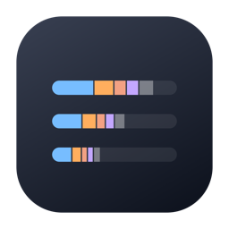
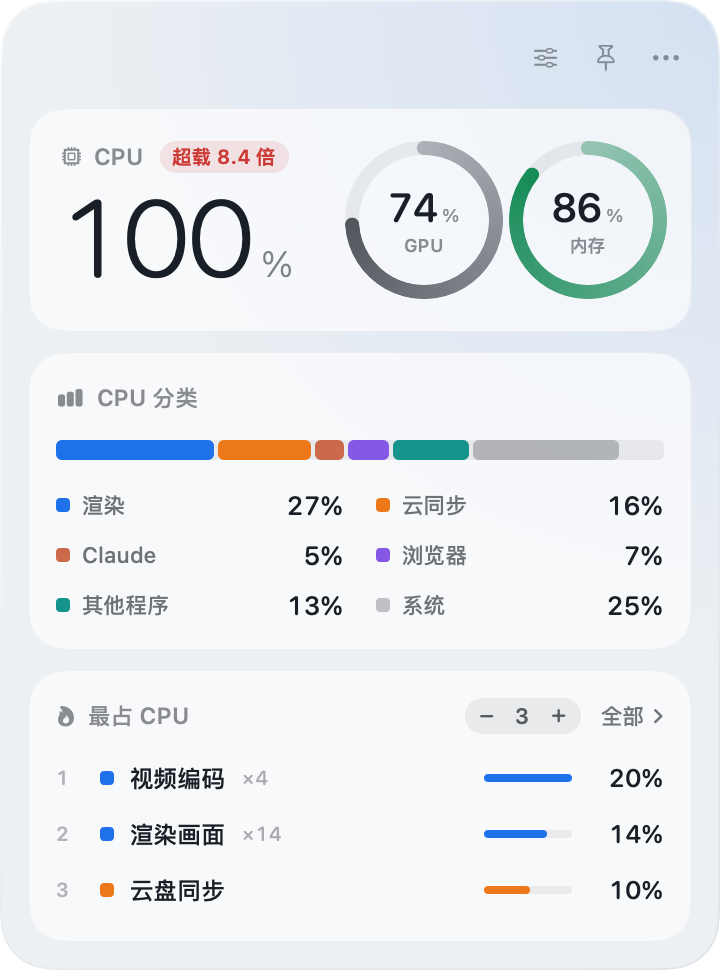

<p align="center"></p>

<h1 align="center">电脑活动</h1>

<p align="center">macOS 桌面小组件。电脑为什么忙、忙在谁身上，放在桌面上一眼看清。</p>

<p align="center">A desktop widget for macOS that shows what your Mac is busy with: CPU, GPU, memory and the programs behind them. The interface is in Chinese.</p>

<p align="center"></p>

## 能做什么

- **总览**：CPU 大数字，显卡和内存两个圆环，百分比按整台电脑算
- **超载几倍**：CPU 满了以后百分比看不出满到什么程度，旁边显示 1 分钟平均负载除以核数，也就是每个核有几个线程在抢
- **CPU 分类**：渲染、云同步、Claude、浏览器、其他程序、系统各占多少
- **最占 CPU**：同名进程合并，显示几个自己调，点开看前 20 个
- **自己搭配**：显示哪几块、先后顺序都能在「自定义」里改；窗口压矮时从最后一块开始收起
- **不打扰**：看得见时每 2 秒采样，被别的窗口挡住每 15 秒，隐藏时停止

## 安装

需要 Apple 芯片的 Mac、macOS 15 或更新版本和 Xcode 命令行工具，不需要完整的 Xcode。

```bash
xcode-select --install
git clone https://github.com/QuincyQiao/computer-widget.git
cd computer-widget
./重新构建.command
```

脚本会编译、跑自测并打开小组件，app 留在这个文件夹里。

## 可选：渲染排队

如果你有一个用锁文件排队的渲染程序，小组件可以多显示一块，看每个位子谁在用、后面排着哪些任务。设好文件夹后重新打开小组件：

```bash
defaults write local.computer.activity.widget queueFolder ~/某处/排队
```

文件夹里 `1.lock`、`2.lock`、`快.lock` 是位子，`排号/`、`排号快/` 里的 `.json` 是排队的号。文件被进程用 `flock` 锁着才算占用，内容是 `{"cwd": "...", "cmd": "...", "at": 时间戳}`。没设这个文件夹时，这一块不会出现。

## 开发

全部代码在 `ComputerWidget.swift` 一个文件里。

- `ComputerWidget --self-test`：自测，构建时自动跑
- `ComputerWidget --render-preview <文件夹>`：用示例数据画出各种状态的预览图
- `COMPUTER_STAGE_ONLY=1 ./重新构建.command`：只编译和自测，不替换正在运行的小组件

## 许可证

[MIT](LICENSE)，Copyright © 2026 Chenxu Qiao。
